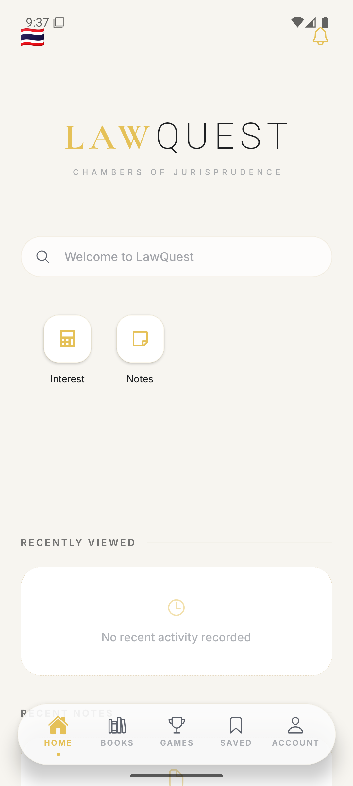
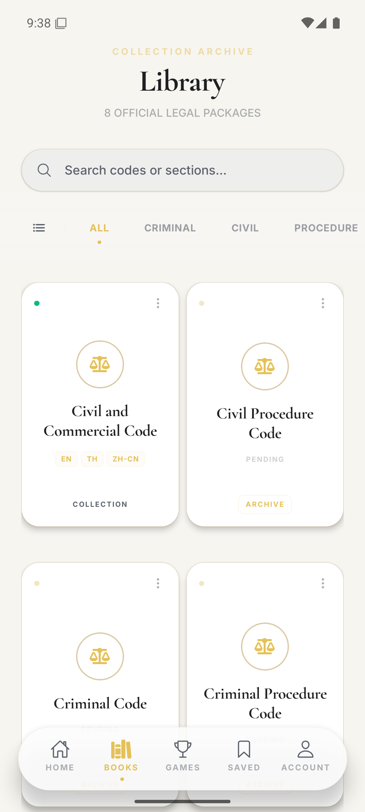
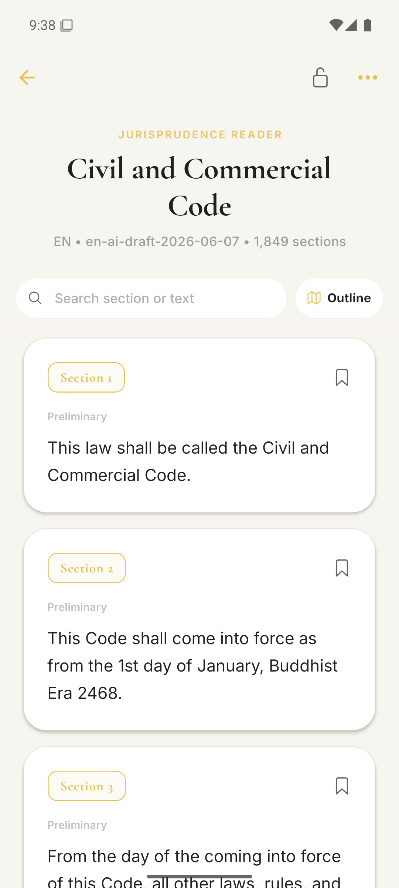
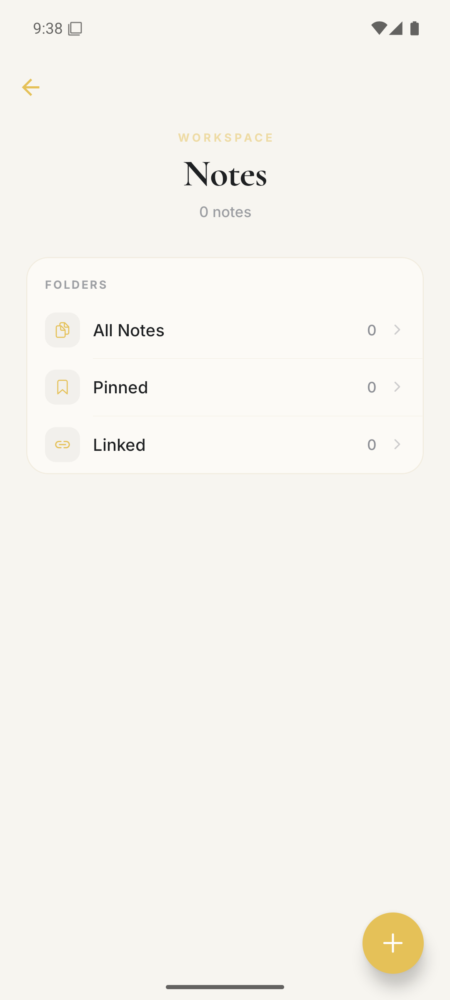
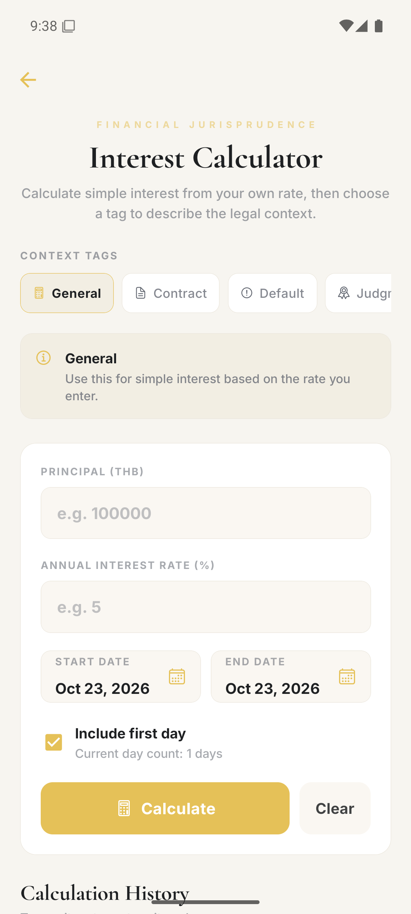
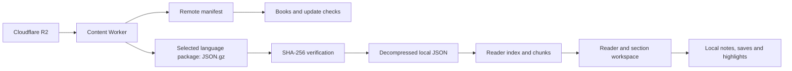

<p align="center">
  
</p>

<h1 align="center">LawQuest</h1>
<p align="center">An offline-first workspace for reading and studying Thai law.</p>
<p align="center">
  <a href="https://github.com/iceswift/lawquest/actions/workflows/ci.yml"></a>
  
  
  
</p>

**One section, one learning workspace.** LawQuest brings legal text, annotations, notes, saved sections, and native text-to-speech into the same reading flow. It is a personal portfolio project by [iceswift](https://github.com/iceswift), currently under active development.

## Preview

Screenshots below are captured from the running Android app, not design mockups.

[Watch the short Android navigation preview](docs/images/walkthrough.mp4).

<table>
  <tr><th>Home</th><th>Books</th><th>Reader</th></tr>
  <tr>
    <td></td>
    <td></td>
    <td></td>
  </tr>
</table>

<details>
  <summary>More screens: Notes and Interest Calculator</summary>
  <p>
    
    
  </p>
</details>

## Why I Am Building This

Studying law often means switching between long documents, handwritten notes, and separate reference tools. LawQuest organizes reading around an individual section while preserving the code's hierarchy: books, parts, titles, chapters, and divisions where applicable.

The goal is to make it easier to navigate legal text, keep personal study material in context, and return to it offline.

## What Works Today

| Area | Implementation |
| --- | --- |
| Books | Remote catalog, per-language downloads, installation status, and update detection |
| Reader | Section navigation, hierarchical outline, and local JSON reading |
| Languages | Thai and English UI; downloadable Thai, English, and Simplified Chinese legal text |
| Section workspace | Saved sections, linked notes, highlights, and native TTS controls |
| Notes | Local notes, folders, pinned notes, and section links |
| Search | Code aliases, exact section lookup, notes, saved sections, tools, and downloaded legal text |
| Tools | Interest calculator with saved calculation history |
| Accounts | Guest use and Supabase email sign-in groundwork; cross-device sync remains planned |

Features are implemented but are not all production-hardened. Games, subscriptions, and complete account sync are not finished.

## Engineering Highlights



- **Separate app and content releases.** Legal packages are downloaded on demand; only a fallback catalog is included in the app source.
- **Prepare content after download.** Gzip is unpacked during installation and reader indexes/chunks are written locally for subsequent reads.
- **Preserve legal identifiers.** Section numbers, suffixes, translations, structural paths, and footnote metadata are modeled separately from display text.
- **Keep study data local.** Notes, saved items, highlights, and recent activity use device storage. Migration tests cover existing storage formats.
- **Learn from implementation tradeoffs.** The legal reader moved from a SQLite experiment to JSON and reader sidecars after instability during rapid navigation. Native stress testing and search memory work remain on the roadmap.

See [architecture](docs/architecture.md), [development setup](docs/development.md), and [roadmap](docs/roadmap.md).

## Run Locally

Use Node.js 22 and npm. Android Emulator or a physical device is recommended for native feature testing.

```sh
git clone https://github.com/iceswift/lawquest.git
cd lawquest
npm ci
npm start
```

Open with an Expo Go version compatible with SDK 54. For Android, start an emulator and press `a` in Expo's terminal. For a web preview, run `npm run web`. Web support is partial; it is not a substitute for testing file downloads, selection, and TTS on a device.

Guest reading and local study do not require your own Supabase account. Optional sign-in setup is documented in [development.md](docs/development.md). The public content service requires internet for catalog refresh and first download; installed content is intended for offline use.

```sh
npx tsc --noEmit
npm run test:services
```

## Project Map

```text
app/             Expo Router screens and navigation
components/      Reader, books, notes, home, and TTS UI
context/         Theme and authentication providers
hooks/           Screen controllers and activity hooks
services/        Content installation, local storage, search, TTS, and auth
constants/       Theme tokens and Thai/English UI translations
cloudflare/      Content Worker source and deployment configuration
data/legal-v3/   Fallback package manifest (full datasets distributed separately)
scripts/         Content build/release tooling and service migration tests
docs/            Setup, architecture, roadmap, and content provenance notes
```

## Scope, Data, and Attribution

Thai source material was collected from the Office of the Council of State. English and Chinese content includes AI-assisted unofficial translations and still needs legal review. Hosting or packaging a text does not make the translation official. See [content and attribution](docs/content-and-attribution.md).

This repository documents a project built with AI assistance for implementation, translation drafts, and iteration. The product direction and development decisions are maintained by the author. See [development case study](docs/case-study.md) for decisions and remaining work.

No open-source license has been selected yet. Public visibility does not grant a license to redistribute the code, branding, fonts, or legal datasets; their permissions must be assessed separately.
